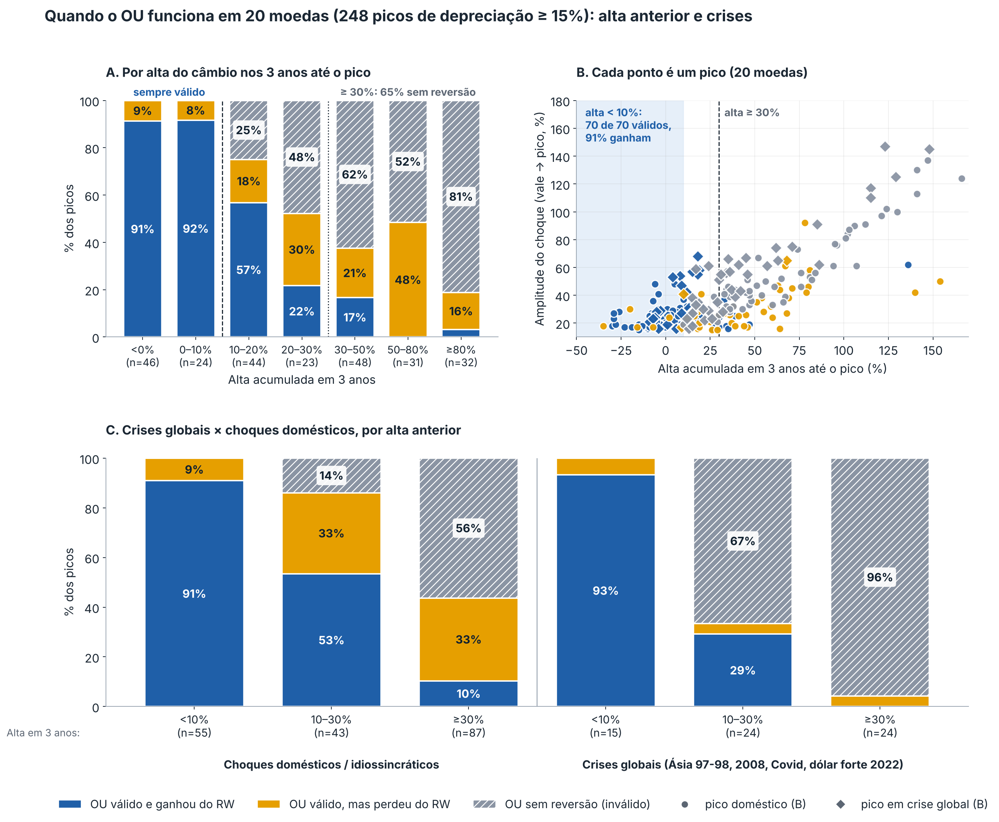
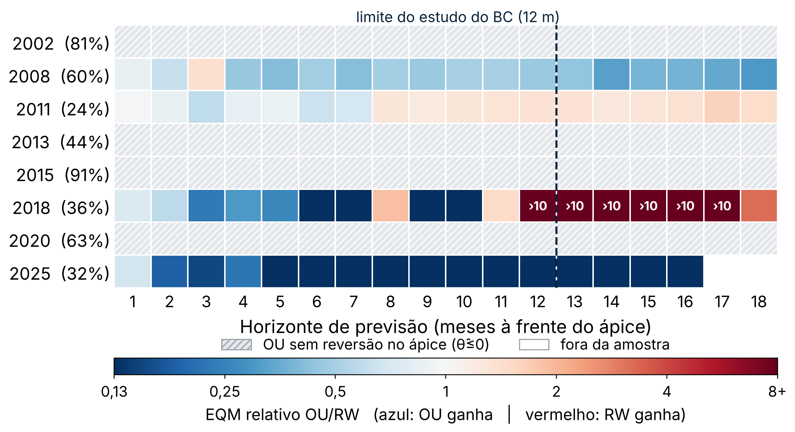
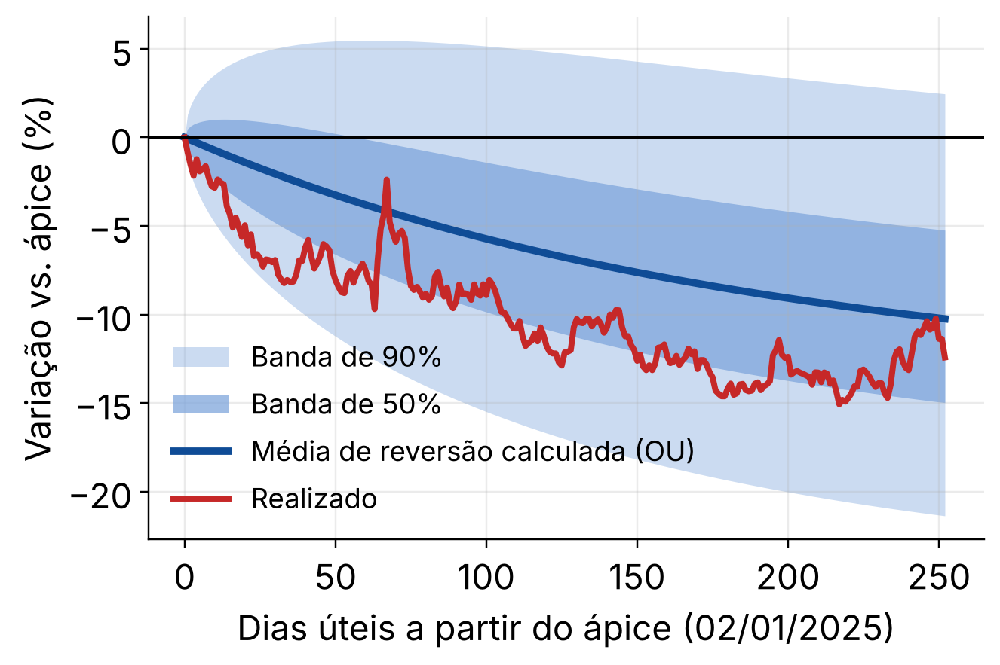
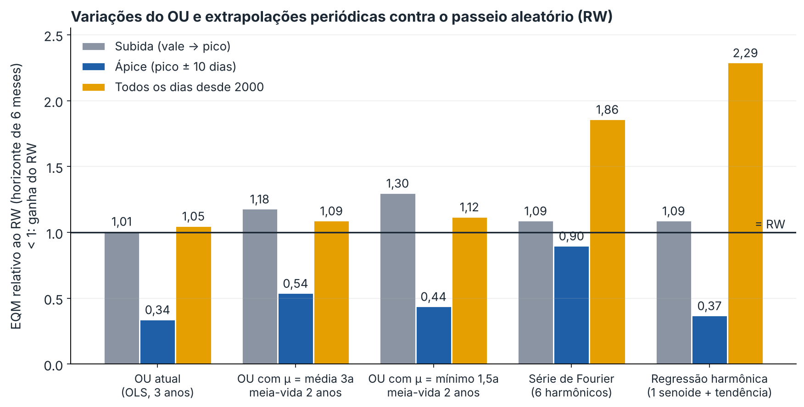

# Modelagem da Taxa de Câmbio com o Processo de Ornstein-Uhlenbeck

Projeto da disciplina **Introdução à Modelagem Matemática**.

O programa modela e projeta a taxa de câmbio do real usando o **processo de Ornstein-Uhlenbeck (OU)**, um modelo que assume que o valor tende a reverter para uma média de longo prazo. Os dados são as cotações diárias do real desde **01/07/1994**.

## O modelo

O processo OU é descrito pela equação diferencial estocástica:

```
dS = θ(μ − S)dt + σ dW
```

| Parâmetro | Significado |
|-----------|-------------|
| θ | velocidade de reversão à média |
| μ | nível de equilíbrio de longo prazo |
| σ | volatilidade |
| W | movimento browniano |

A estimação é feita por **mínimos quadrados (OLS)** na forma discreta:

```
ΔS_t = α + β·S_{t-1} + ε_t
θ = −β        μ = α/θ        σ = desvio-padrão dos resíduos
meia-vida = ln(2)/θ
```

## Como o programa funciona

1. **Tratamento de dados e filtro de período**
   Lê o arquivo histórico (`cambio.csv`) e permite escolher o período analisado pela linha de comando: data de início, data de fim ou apenas os últimos N anos.

2. **Ajuste do modelo**
   Estima θ, μ e σ, além da meia-vida e do R² da regressão. A estabilidade da série é verificada com um teste de estacionaridade **ADF** otimizado (número de lags escolhido por AIC com *early-stopping*; valor crítico de 5% = −2,86).

3. **Simulação e projeção futura**
   Roda uma **simulação de Monte Carlo** (1000 trajetórias) para projetar o câmbio 2 anos à frente (diário e mensal), com bandas de incerteza de 50% e 90%. A projeção é comparada com o valor realizado, quando ele existe nos dados.

### Módulo de validação (Estudo BC nº 25/2018)

O código também faz um **backtest rolling** que compara o modelo OU com o **passeio aleatório** (benchmark), calculando:

- EQM relativo (OU/RW): valores menores que 1 indicam que o OU supera o passeio aleatório
- Teste de **Diebold-Mariano** (com correção de Harvey-Leybourne-Newbold)
- **Decomposição de Theil** do erro (viés, variância e covariância)
- RMSE e MAE por horizonte
- Tabela de EQM relativo por fator *k* (percentis de variação), comparada com os valores de referência do paper do BC

## Requisitos

- Python 3.8+
- `pandas`, `numpy`, `matplotlib`, `scipy`

```bash
pip install pandas numpy matplotlib scipy
```

## Formato dos dados

O CSV de entrada deve ter as colunas `data` e `valor`:

```csv
data,valor
1994-07-01,0.9
1994-07-04,0.89
...
```

O código aceita números com vírgula ou ponto decimal.

## Uso

```bash
# Todos os dados disponíveis
python cambio_ou_modelo.py

# A partir de uma data
python cambio_ou_modelo.py --inicio 2015-01-01

# Intervalo específico
python cambio_ou_modelo.py --inicio 2015-01-01 --fim 2023-12-31

# Últimos 5 anos (sobrepõe --inicio/--fim)
python cambio_ou_modelo.py --anos_recentes 5

# Ajustando o backtest do BC
python cambio_ou_modelo.py --bc_janela 3 --bc_horizonte 6
```

### Argumentos

| Argumento | Descrição | Padrão |
|-----------|-----------|--------|
| `--csv` | Arquivo CSV de entrada | `cambio.csv` |
| `--inicio` | Data inicial (AAAA-MM-DD) | — |
| `--fim` | Data final (AAAA-MM-DD) | — |
| `--anos_recentes` | Usa apenas os últimos N anos | — |
| `--bc_janela` | Janela (anos) do backtest BC | 5 |
| `--bc_horizonte` | Horizonte máximo (períodos) do backtest BC | 12 |

## Saídas

As pastas são nomeadas pelo período analisado e **nunca sobrescrevem** resultados anteriores (se já existir, é criado o sufixo `_v2`, `_v3`, ...).

```
resultados_ou_AAAAMMDD-AAAAMMDD/
├── diario/
│   ├── 01_serie_projecao_diario.png     # série + projeção Monte Carlo
│   ├── 02_residuos_diario.png
│   ├── 03_qqplot_diario.png
│   ├── 04_distribuicao_residuos_diario.png
│   ├── 05_acf_residuos_diario.png
│   ├── 06_forca_reversao_diario.png
│   ├── 07_dispersao_delta_diario.png
│   ├── OU_global.csv                    # parâmetros estimados
│   └── debug/
└── mensal/
    ├── 01_... a 07_... (idem)
    ├── 08_mensal_dia1_projecao.png
    ├── OU_global.csv
    └── debug/

resultados_bc_AAAAMMDD-AAAAMMDD/
├── diario/ e mensal/
│   ├── bc_A_eqm_relativo_*.png
│   ├── bc_B_diebold_mariano_*.png
│   ├── bc_C_decomposicao_theil_*.png
│   ├── bc_D_rmse_mae_*.png
│   ├── bc_E_tabela2_*.png
│   ├── tabela1_*.csv
│   └── tabela2_*.csv
```

## Observações

- O gráfico principal da série diária abre uma **janela interativa** (zoom, pan e salvar). Feche a janela para a execução continuar. O PNG também é salvo automaticamente. Em ambientes sem interface gráfica, essa etapa pode falhar.
- Se o ADF indicar série **não estacionária**, o programa avisa que o modelo OU é suspeito para aquele período.
- Se θ ≤ 0 (sem reversão à média), o modelo é considerado inválido e nenhum resultado é salvo para aquela frequência.
- O modelo não é uma recomendação financeira. É um exercício acadêmico de modelagem.

## Resultados exploratórios

Os testes abaixo usaram este código no câmbio do real (SGS 1, 1999–2026) e o mesmo procedimento em 20 moedas contra o dólar (séries diárias do Federal Reserve). Os picos e vales foram identificados *a posteriori*, as amostras são pequenas e os limiares foram escolhidos após olhar os dados, então os resultados são indícios, não regras. As figuras ficam na pasta `docs/`.

### Quando o OU funciona bem: choques precedidos de alta pequena

O OU reverte bem os choques em que o câmbio **não vinha de uma alta longa**. Em 248 picos de depreciação de pelo menos 15% (20 moedas), os 70 picos precedidos de alta inferior a 10% nos 3 anos anteriores tiveram reversão estimada em **todos** os casos (70 de 70), e o OU ganhou do passeio aleatório em 6 meses em **91%** deles. Com alta de 30% ou mais, a reversão só foi estimada em 35% dos picos, e o OU ganhou em 8%.

Esse resultado vale tanto para choques domésticos (91%) quanto para crises globais (93%). Nos vales (apreciações), o padrão é parecido, mas mais fraco: com variação anterior menor que 10%, o OU ganhou em 69% dos casos.



No real, os choques de 2008, 2011, 2018 e 2025, que vieram depois de altas de 6% a 14% em 3 anos, são os que o OU reverteu. Os de 2002, 2013, 2015 e 2020, precedidos de altas de 39% a 107%, não tiveram reversão estimada no ápice.



Exemplo de bom comportamento: no ápice de 2025 (02/01/2025), a média de reversão calculada pelo OU previu uma queda de 10,2% em 12 meses e o realizado foi de 12,4%. O câmbio realizado ficou dentro da banda de 90% em todos os dias e dentro da banda de 50% em 52% deles.



### Outros testes

Além do OU com parâmetros estimados por OLS, foram testadas variações do modelo e duas extrapolações periódicas, contra o passeio aleatório (RW). O gráfico mostra o EQM relativo em 6 meses (< 1 ganha do RW) em três situações: na subida do choque, no ápice e em todos os dias desde 2000.



- **Trocar o μ** (média de 3 anos ou mínimo de 1,5 ano, com meia-vida fixa de 2 anos) reduz o erro no ápice e recupera a reversão em parte dos choques em que o OLS falhava, como 2002 e 2015. Fora do ápice, piora em 9% a 12%.
- **Extrapolação periódica** (série de Fourier ou regressão harmônica) não converge para um nível, por isso o erro aumenta com o horizonte. O erro chega a 1,9 e 2,3 vezes o do RW em todos os dias.
- **Modelo SIR** aplicado à curva do choque não previu o momento do pico (0 de 8 acertos com 90% da subida percorrida) e as projeções ficaram muito piores que as do RW. Os parâmetros estimados são instáveis.
- **Ex post × ex ante:** o ganho no ápice depende de saber que se está no ápice. Na subida, nenhuma variante ganha do RW.

Observação: no gráfico, o "OU atual" no ápice considera o RW (razão = 1) nos choques em que a estimação por OLS é inválida.

## Possíveis melhorias

Resultados abaixo vêm de testes exploratórios com este código e com séries do BCB (SGS 1) e do Federal Reserve (20 moedas). Os picos e vales foram identificados *a posteriori* e as amostras são pequenas, então tratam-se de indícios, não de regras.

### 1. Condicionar o uso do OU ao comportamento recente do câmbio

Hoje o modelo só é descartado quando θ ≤ 0 ou quando o ADF indica não estacionariedade. Nos testes, a **alta acumulada do câmbio nos 3 anos anteriores ao pico** separou melhor os casos em que o OU funciona:

| Alta nos 3 anos | OU válido | OU ganha do passeio aleatório (6 m) |
|-----------------|-----------|--------------------------------------|
| < 10% | 70 de 70 picos | 91% |
| 10–30% | zona mista | 45% |
| ≥ 30% | 35% | 8% |

(248 picos de depreciação ≥ 15% em 20 moedas contra o dólar. Em 25 picos locais do real, a reversão foi estimada em 9 de 9 com alta < 30% e em 4 de 16 com alta ≥ 30%; Fisher exato, p < 0,001.)

- Emitir um **aviso adicional** quando a alta acumulada em 3 anos for ≥ 30%, além do aviso do ADF.
- Os limiares foram escolhidos após olhar os dados. Validá-los fora da amostra (outras moedas, outros períodos) antes de tratá-los como regra.

### 2. Estimação e parâmetros

- **Janela móvel de 3 anos**, reestimada a cada dia, em vez de uma única estimação sobre todo o período. Foi a janela que melhor funcionou; a de 2 anos não reproduziu o ganho.
- **Log do câmbio** como variável do modelo, garantindo positividade e simulando com exponencial.
- **Meia-vida fixa e μ de longo prazo** (por exemplo, média de 3 anos e meia-vida de 2 anos) como alternativa quando a estimação por OLS é inválida. Em testes, isso recuperou a reversão em parte dos choques no ápice, mas custou 6% a 24% de EQM fora do ápice. Usar apenas como cenário, não como previsão geral.
- Incluir **intervalo de confiança dos parâmetros** (bootstrap em blocos), já que θ̂ é muito instável perto de zero.

### 3. Avaliação (backtest)

- Reportar o EQM relativo **por fase do choque** (início, ascensão, ápice, declínio, estabilização), e não só por horizonte, para ver *quando* o OU ganha.
- Separar avaliação **ex post** (origem escolhida sabendo o pico) de **ex ante** (só informação disponível). O ganho no ápice some quando o ápice não é conhecido de antemão.
- Testes de significância por choque (Diebold–Mariano com bootstrap em blocos) e correção para múltiplos testes. Hoje os resultados por choque são descritivos.
- **Documentar e tornar reproduzível o fator *k***, o percentual das menores variações de 4 meses excluídas da amostra (k = 0 usa tudo, k = 90 mantém os 10% maiores). A linha OU (k = 90) da tabela comparativa com o BC ainda não é reproduzida com os scripts atuais e precisa de um script único e conferível.

### 4. Extensões do modelo

- **Segundas ondas.** Em 5 de 8 choques do real houve um novo pico com 83% a 98% da amplitude em cerca de 5 meses, o que interrompe a reversão projetada. Modelos com saltos ou mudança de regime (por exemplo, Markov-switching) podem capturar isso.
- **Outros benchmarks:** passeio aleatório com deriva, AR(p), ARIMA e GARCH para a volatilidade, além do Focus.
- **Outras moedas e choques de apreciação** (vales). O padrão se repete, mas com validade mais frequente nos vales (81%) do que nos picos (62%).
- **Mais variáveis:** diferencial de juros, termos de troca, risco-país. O OU univariado ignora os fundamentos.

### 5. Engenharia e reprodutibilidade

- **Modo sem janela interativa** (`--sem_janela` ou backend `Agg`), já que a janela do gráfico principal pode falhar em ambientes sem interface.
- **Semente aleatória** (`--seed`) para a simulação de Monte Carlo ser reprodutível.
- **Download automático da série SGS 1** do BCB em janelas de até 10 anos (limite da API), em vez de depender de `cambio.csv` manual.
- **Testes automatizados:** simular um OU com θ, μ e σ conhecidos e verificar se a estimação recupera os valores; testar o tratamento de vírgula e ponto decimal.
- Arquivo `requirements.txt` com versões fixas, e salvar no CSV de saída os parâmetros da execução (período, janela, versão).

### Alternativas já testadas e descartadas

- **Extrapolação periódica** (série de Fourier truncada ou regressão harmônica com períodos ajustados): pior que o passeio aleatório em quase todas as origens, inclusive no ápice.
- **Modelo SIR** aplicado à curva do choque: não previu o momento do pico (0 de 8 acertos a 90% da subida) e as projeções ficaram muito pior que o passeio aleatório, com parâmetros instáveis.
- **Outras definições de μ** (média de 5 e 10 anos, mínimo recente): não superam o OLS antes do pico e pioram fora do ápice.

## Autor

**Matheus Henrique Gomes dos Santos**
Instituto de Matemática e Estatística (IME), Universidade Federal de Goiás (UFG)
